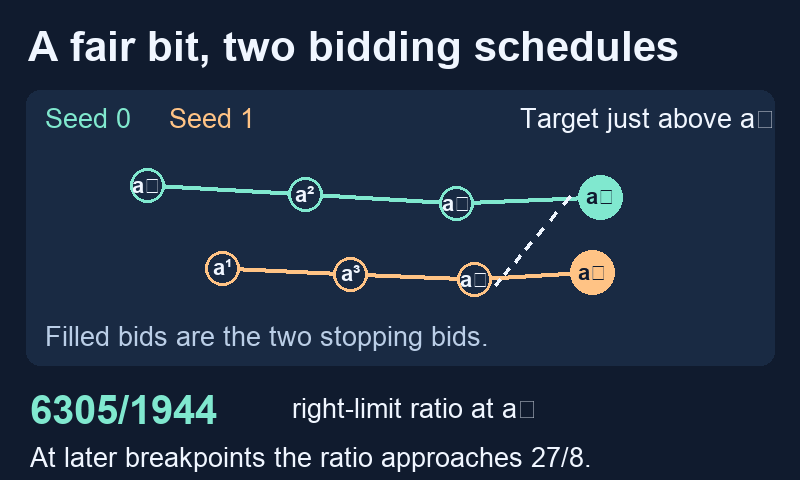

# Online bidding with one fair bit

   

One fair bit gives an optimal worst-target expected competitive ratio of 27/8 in online bidding. More generally, with k equally likely seeds the optimum is (1+1/k)^(k+1). This note answers Angelopoulos and Simon’s one-random-bit question by applying classical cyclic contract scheduling. It also gives a direct lower-bound proof.

[Read the paper](paper/manuscript.pdf) · [LaTeX source](paper/manuscript.tex) · [Original question](https://arxiv.org/html/2510.25582#S6) · [Catalog Q459](https://github.com/10m-u/open-problems-catalog/blob/ca8d4d44ba3db527f19f28928c240168f545ecfe/problems/computer_science_ai/theory-of-computation-algorithms-part-1.md#q459) · [Version DOI](https://doi.org/10.5281/zenodo.24571176)

## Explore the proof in 3D

With two seeds set a = 3/2. The first seed bids the even powers and the second bids the odd powers. A target just above a⁵ makes them stop at a⁶ and a⁷. Their combined charge is the first eight bids of the merged list. Move the threshold to a later breakpoint to see the expected ratio approach 27/8.

[Download the offline explorer](https://raw.githubusercontent.com/DannyExperiments/online-bidding-one-fair-bit/v1.0.0/visualization/interleaved-bids-explorer.zip) · [Explorer source](visualization/index.html) · [GIF rendering source](visualization/render.py)

## Why the proof works

Every bid below the target is paid by its seed. The final payment adds one stopping bid from each seed. The smallest possible total charge on a fixed merged list takes the first k available bids as these stopping bids. A cyclic assignment attains that prefix bound for every target. Running the resulting list as consecutive cyclic contracts gives a classical acceleration-ratio problem. The proof credits both normalizations of the scheduling theorem and treats ties explicitly.

## Reproduce the checks

    python3 -I scripts/verify_repository.py
    python3 -I verification/src/replay.py

The [recorded replay](verification/results/replay.txt) checks geometric targets, inclusive endpoints, limiting ratios, tied schedules and the worked example. The [paper](paper/manuscript.pdf) proves the general result. See [scope](CLAIM_SCOPE_AND_LIMITATIONS.md), [reproducibility](REPRODUCIBILITY.md) and the [research disclosure](AI_DISCLOSURE.md).

## Cite

DannyExperiments. *Online bidding with one fair bit*. Version 1.0.0, 27 November 2026. [Version DOI](https://doi.org/10.5281/zenodo.24571176).
